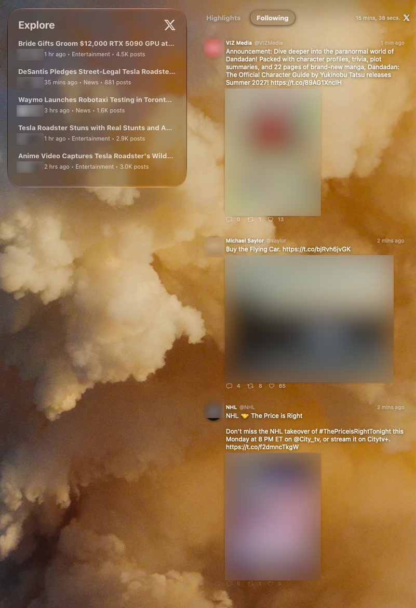

# X Widget

Your X timeline, live on the macOS desktop: a full-height feed panel with no widget box, plus a WidgetKit widget.



<sub>Left: X's own Explore widget. Right: X Widget's desktop feed. Avatars and post images are blurred for privacy.</sub>

## Why

X's macOS widget shows Explore trends in a fixed-size box. X Widget shows **your own timeline** instead, in a panel that runs the full height of the screen, sits on the desktop behind your windows, and updates live.

| | X's widget | X Widget |
| --- | --- | --- |
| Content | Explore trends | Your **Following** timeline and **Highlights** |
| Layout | Fixed widget box | Full-height panel, no box, on any display and either screen edge |
| Updates | WidgetKit refresh schedule | Live polling, every 30 seconds to 15 minutes |
| Media | Avatars | Photos, plus video and GIF previews |
| Scrolling | Fixed list | Scrolls back through up to 300 posts already fetched |

A standard WidgetKit widget (Medium, Large and Extra Large) is included too, for people who prefer the widget gallery.

## Features

- **Following:** your reverse-chronological home timeline.
- **Highlights:** the same posts ranked by engagement and recency. X's public API doesn't offer the algorithmic For You feed, so Highlights borrows rules from [X's open-source For You pipeline](https://github.com/xai-org/x-algorithm) instead: a 48-hour window, repost deduplication, a discount on reposts and replies, and author diversity. It's computed from posts already fetched, so it costs no extra API calls.
- **Desktop panel:** glass cards or no background, adjustable width, and a choice of display. Click a post to open it on x.com.
- **Images:** up to four per post, laid out the way X shows them. This can be turned off in Settings.
- **Menu bar app:** no Dock icon. Refresh, show or hide the panel, and switch displays from the menu bar.
- **Start at login:** off by default. Turn it on in Settings → General. It follows macOS's Login Items, so changes made in System Settings show up here too.
- **Guided setup:** a step-by-step walkthrough for connecting your own X developer app.

## Install

1. Download the latest `XWidget-x.y.z.dmg` from [Releases](https://github.com/poonasor/x-widget/releases).
2. Open it and drag **X Widget** to Applications. The DMG is signed with Developer ID and notarized by Apple.
3. Launch X Widget. Its icon appears in the menu bar.

**Requires** macOS 26 or later.

## Connect your X account

X Widget reads your timeline through the official X API using **your own** developer app, so you control access and API spending. Open **Settings → X Account** and follow the four steps there:

1. Create a client application at [console.x.com](https://console.x.com) under the Pay Per Use project, and add some credits.
2. On the app's **Keys & Tokens** tab, under **OAuth 2.0 Keys**, click **Set up** next to User authentication settings. Choose **Read** permissions, **Native App** type, callback `xwidget://oauth/callback`, and any website URL.
3. Paste the **Client ID** into X Widget.
4. Click **Sign in with X**.

Until you connect an account, the app shows demo posts.

### API usage

X API reads are billed to your developer account. X Widget keeps that low in three ways:

- Each poll asks only for posts newer than the last one it has (`since_id`). Longer poll intervals cost less.
- Scrolling and Highlights only use posts already fetched; they never make requests.
- The widget reuses the app's cached feed for up to 15 minutes instead of fetching its own.

### Privacy

Your OAuth tokens are stored in the macOS keychain and shared only with the widget extension. There's no server: the app talks only to `api.x.com`, and to `pbs.twimg.com` for images.

## Build from source

```bash
brew install xcodegen
xcodegen generate
open XWidget.xcodeproj
```

The Xcode project is generated from `project.yml`. Edit that file rather than the project, then run `xcodegen generate` again.

To build a signed, notarized DMG, first store notarization credentials once:

```bash
xcrun notarytool store-credentials x-widget-notary --apple-id <Apple ID> --team-id <Team ID>
```

Then build:

```bash
scripts/build-dmg.sh
```

The DMG is written to `build/release/`. Use `SKIP_NOTARIZE=1 scripts/build-dmg.sh` for a quick signed-only build.

`swift scripts/make-icons.swift` regenerates the app and menu bar icons.

### Project layout

| Path | What's in it |
| --- | --- |
| `XWidget/` | Menu bar app, desktop panel, settings, OAuth sign-in |
| `FeedWidget/` | WidgetKit extension |
| `Shared/` | Models, X API client, feed cache, Highlights ranking, post views. Compiled into both targets. |
| `scripts/` | DMG build and icon generation |

## Known limitations

- **No For You feed:** X's public API doesn't offer it. Highlights is the closest approximation.
- **Images only on new posts:** posts cached before image support was added stay text-only, and reposts don't show the original post's images.
- **Text-only widget:** WidgetKit can't load remote images while rendering.

## Disclaimer

X Widget is an independent project. It isn't affiliated with, endorsed by or sponsored by X Corp. "X" is a trademark of X Corp.
